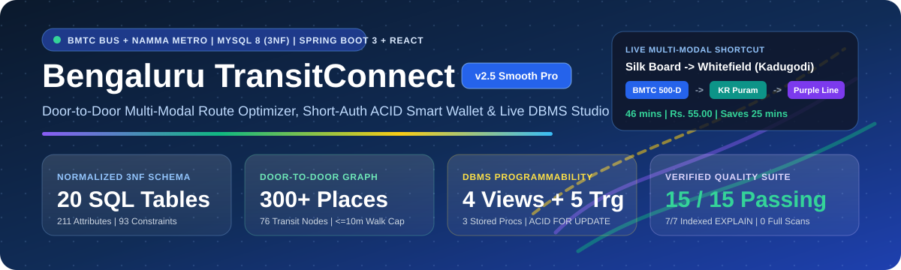
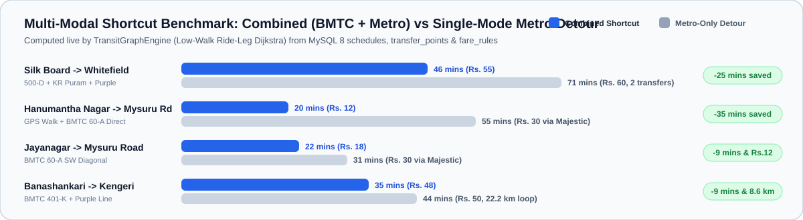
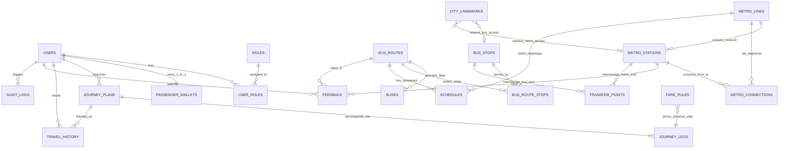
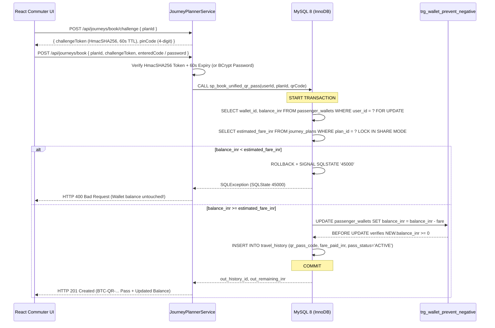
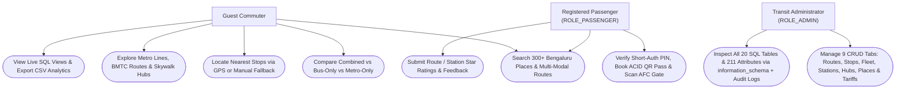

<a id="readme-top"></a>

<div align="center">



<br />

[](#tech-stack)
[](#api-playground)
[](#interactive-sql-explorer)
[](#interactive-tours)
[](#quick-start)
[](LICENSE)

<p align="center">
  <strong>Multi-Modal Public Transport Route Optimizer, Short-Auth ACID Smart Wallet &amp; Live MySQL 8 DBMS Intelligence Studio for BMTC Bus + Namma Metro</strong>
</p>

<p align="center">
  <a href="#interactive-tours"><strong>Interactive Role Tours</strong></a> &bull;
  <a href="#corridor-benchmarks"><strong>Shortcut Benchmarks</strong></a> &bull;
  <a href="#architecture-diagrams"><strong>Live Mermaid Diagrams</strong></a> &bull;
  <a href="#interactive-sql-explorer"><strong>20-Table SQL Explorer</strong></a> &bull;
  <a href="#api-playground"><strong>API Playground</strong></a> &bull;
  <a href="#quick-start"><strong>1-Command Setup</strong></a> &bull;
  <a href="#viva-flashcards"><strong>Viva Q&amp;A Flashcards</strong></a>
</p>

</div>

---

> [!TIP]
> **How to use this Interactive README:** Click any **expandable drawer (`>`)** below to explore role-specific guided tours, inspect all **20 `3NF` SQL tables & 211 attributes**, copy live `curl` / PowerShell API calls, or quiz yourself with **click-to-reveal DBMS Viva flashcards**. Every Mermaid diagram also supports **interactive zoom & pan** directly on GitHub.

---

## Why Bengaluru TransitConnect Exists

Commuters in Bengaluru navigate two complementary public transit systems operated by separate agencies:

- **BMTC (*Bengaluru Metropolitan Transport Corporation*)**: High-frequency Ordinary, Electric, Vajra AC (`500-D`, `500-CA`, `335-E`, `201-R`, `60-A`, `401-K`), Metro Feeder (`MF-1`), and Vayu Vajra Airport (`KIA-8`) bus corridors.
- **BMRCL *Namma Metro***: Rapid rail across the **Purple Line** (*Challaghatta -> Whitefield (Kadugodi)*), **Green Line** (*Madavara -> Silk Institute*), and **Yellow Line** (*RV Road -> Bommasandra via Jayadeva, BTM Layout, Central Silk Board & Electronic City*).

Because the Outer Ring Road **Blue Line (Phase 2A: Silk Board -> KR Puram)** is still under construction, single-mode travel from **Silk Board Junction** to **Whitefield (Kadugodi)** either sits in full-corridor road traffic (`Bus-Only: 59 mins, Rs. 60`) or detours west through two Metro interchanges at RV Road and Majestic (`Metro-Only: 71 mins, Rs. 60, 2 transfers`).

**Bengaluru TransitConnect** models both networks in a **20-table Third Normal Form (`3NF`) MySQL 8 database** (`31` Metro stations, `45` BMTC bus stops, `13` BMTC routes, `15` transfer hubs, `300` street-address Bengaluru landmarks across `10` categories) and runs a **Low-Walk Multi-Criteria Ride-Leg Dijkstra Optimizer** to discover faster, cheaper multi-modal combinations such as:

```text
Silk Board Junction  --[BMTC 500-D]-->  KR Puram Skywalk Hub  --[Namma Metro Purple Line]-->  Whitefield (Kadugodi)
Total Journey: 46 mins  |  Fare: Rs. 55.00  |  Transfers: 1  |  Saves 25 mins & 7.7 km vs Metro-Only!
```

<a id="tech-stack"></a>

### Core Engineering Pillar Matrix

| Layer | Technology & Engineering Design | Verified Proof in Repo |
| :--- | :--- | :--- |
| **Relational DBMS** | **MySQL 8.x (InnoDB, `utf8mb4`)** as single persistent source of truth (`0` static JS data arrays) | `20` `3NF` tables, `211` attributes, `93` constraints (`33 CHECK`, `22 FK`, `20 PK`, `18 UNIQUE`) |
| **SQL Programmability** | **4 Analytical `VIEW`s, 5 `TRIGGER`s, 3 `STORED PROCEDURE`s** + `EXPLAIN` index tuning | `sp_book_unified_qr_pass` (`SELECT ... FOR UPDATE`), `7/7` indexed `EXPLAIN` plans (`0` table scans) |
| **Backend API & Graph Engine** | **Java 21 LTS + Spring Boot 3.4.3** (`Spring Security`, `JPA` + `JdbcTemplate`, `ddl-auto=validate`) | Multi-criteria Dijkstra (`FASTEST`, `CHEAPEST`, `MIN_TRANSFERS`) + `15/15` Live MySQL JUnit tests |
| **Security & Booking Shield** | **BCrypt (`$2a$10$`) + Stateless JWT + Short-Auth `HmacSHA256` PIN** + `ROLE_ADMIN` RBAC | Prevents accidental wallet debits, blocks SQL injection, masks hashes in live schema inspector |
| **Frontend Experience** | **React 18 + Vite 5 + Tailwind CSS 3 + Leaflet 1.9.4** (Day/Night map, TTL cache, 0ms tab switch) | 300+ Bengaluru place search, GPS + manual fallback, SVG QR pass download & Admin SQL Explorer |
| **Data Honesty Policy** | Explicit **`OFFICIAL_PUBLISHED`** vs **`SCHEDULED_SAMPLE`** badges across all routes & headways | Never fabricates fake live bus GPS coordinates; simulates AFC gate scan transparently |

---

<a id="interactive-tours"></a>

## Interactive Guided Tours (Choose Your Persona)

Click any persona below to expand a tailored **60-to-180 second hands-on walkthrough** of the running platform at `http://localhost:5173`:

<details open>
<summary><strong>1. Commuter / First-Time Visitor Tour (60 Seconds: Door-to-Door Routing -> QR Pass -> Gate Scan)</strong></summary>

<br />

1. **Pick Any Bengaluru Origin & Destination (300+ Street-Address Landmarks)**:
   - Open **Journey Planner** (`http://localhost:5173`). Type `"Vidhana Soudha"`, `"RV College"`, `"Manyata"`, or click the **Silk Board -> Whitefield** preset pill.
   - Use keyboard navigation (<kbd>Up</kbd> <kbd>Down</kbd> <kbd>Enter</kbd> <kbd>Esc</kbd>) inside the Origin/Destination search bar, or click **Use My GPS** (if GPS permission is denied, manual place/pin selection works seamlessly with zero errors).
2. **Compare Multi-Modal Optimization Modes**:
   - Switch between **Fastest**, **Cheapest**, and **Min Transfers**, and inspect the side-by-side **Combined vs Bus-Only vs Metro-Only** cards.
   - Toggle **Night Map** on the interactive Leaflet map to watch animated corridor polylines and skywalk transfer markers.
3. **Book a Unified NCMC QR Pass (With Short-Auth Shield)**:
   - Click **Sign In** -> 1-click fill **Arjun Rao (`Rs. 450.00` wallet)** -> click **Book Unified QR Pass**.
   - Enter the 60-second **4-digit Short-Auth PIN** (or account password) to confirm intentional wallet deduction.
4. **Download Offline SVG Pass & Simulate AFC Turnstile Scan**:
   - Click **Download Pass SVG** for offline phone use, then click **Simulate Gate Scan** to transition the MySQL `travel_history.pass_status` from `ACTIVE` -> `USED`.

</details>

<details>
<summary><strong>2. Transit Administrator Tour (`ROLE_ADMIN` Studio + Dedicated MySQL Tables &amp; Attributes Explorer)</strong></summary>

<br />

1. **Sign In with `ROLE_ADMIN`**:
   - Open **Sign In** -> click **Siddharth Kulkarni (`admin@transitconnect.in` / `Admin@123`)** -> open the **Admin Studio** tab.
2. **Inspect Live MySQL Schema & Attributes (`MySQL Tables & Attributes` Mode)**:
   - Click the **`MySQL Tables & Attributes`** button in the top-right Admin Studio hero banner.
   - Operational KPI cards and CRUD forms hide automatically so **only your 20 MySQL `3NF` Base Tables and their 211 live attributes** (`information_schema.COLUMNS` + `KEY_COLUMN_USAGE`) are displayed with `PK`, `FK -> parent(col)`, `UQ`, `NOT NULL`, `DEFAULT`, and live `SELECT COUNT(*)` row badges.
   - Click **Inspect SQL / Rows** on any table card to view its live `SHOW CREATE TABLE` DDL and masked sample rows (`password_hash` automatically redacted as `[MASKED_BCRYPT_HASH]`).
3. **Trigger Immutable SQL Audit Logs via Live CRUD**:
   - Exit back to **Operational CRUD**, edit any BMTC route headway or distance-slab tariff across the **9 Admin tabs**, and open **Trigger Audit Logs** to inspect the `OLD` vs `NEW` JSON snapshot captured automatically by MySQL `AFTER UPDATE` triggers (`trg_bus_routes_after_update`, `trg_fare_rules_after_update`).

</details>

<details>
<summary><strong>3. DBMS Professor / Viva Examiner Checklist (3-Minute Live Verification)</strong></summary>

<br />

| Viva Check | Exact Action in App / CLI | Expected Live DBMS Outcome |
| :--- | :--- | :--- |
| **ACID Rollback (`SQLSTATE 45000`)** | Sign in as **Kavya Nair (`Rs. 35.00` wallet)** and book a **Rs. 55.00** Silk Board -> Whitefield pass | `sp_book_unified_qr_pass` locks wallet (`FOR UPDATE`), detects `35 < 55`, executes `ROLLBACK`, wallet stays **Rs. 35.00** |
| **RBAC `HTTP 403` Proof** | Sign in as a passenger (`arjun.rao@bengaluru.in`), open **Admin Studio**, click **Test Live `/api/admin/inventory`** | Spring Security rejects non-admin JWT with **`HTTP 403 Forbidden`** |
| **Live `information_schema` Catalog** | Sign in as Admin -> click **`MySQL Tables & Attributes`** | Displays all **20 Base Tables + 4 Views + 211 Columns + 93 Constraints** queried live from MySQL |
| **4 Analytical SQL Views** | Open **SQL Analytics** tab and click **Export CSV** | Live `JOIN` + `GROUP BY` + `LEFT JOIN` results from all 4 MySQL `VIEW`s |
| **Zero Full-Table Scans + 15 JUnit Tests** | Run `.\scripts\verify_phase9_all.ps1` or `.\scripts\test_backend.ps1` | **`7/7` indexed `EXPLAIN` plans** (`0` `ALL` scans) + **`15/15` passing JUnit 5 integration tests** |

</details>

---

<a id="corridor-benchmarks"></a>

## Multi-Modal Shortcut Benchmarks (Real 2026 Bengaluru Corridors)

<div align="center">
  
</div>

<br />

### Exact Door-to-Door Cost & Low-Walk (`<= 10 min`) Guarantee

```text
Total Journey Time = Origin Walk + Bus Ride + Metro Ride + Boarding Headway Wait + Skywalk Transfer Time
```

- **Low-Walk Snapping (`<= 0.75 km` / `<= 10 mins`)**: When a commuter searches from GPS coordinates or any of the **300+ street-address landmarks** (`city_landmarks`), `TransitGraphEngine` walks directly (`1-10 mins`) if a station/stop is within `0.75 km`; beyond `0.75 km`, it inserts a real MySQL `BMTC_ORDINARY` slab-fare feeder leg (`4 min` walk) so walking never balloons to unrealistic 30-55 minute treks.

| Corridor & Origin Mode | Direct / Multi-Modal Shortcut (`COMBINED`) | Single-Mode Metro Detour (`METRO_ONLY`) | Net Savings |
| :--- | :--- | :--- | :--- |
| **Silk Board -> Whitefield (Kadugodi)** | `BMTC 500-D` -> `KR Puram Skywalk` -> `Purple Line` (**46 mins**, Rs. 55, `29.1 km`) | `Yellow` -> `RV Road` -> `Green` -> `Majestic` -> `Purple` (**71 mins**, Rs. 60, `36.8 km`) | **25 mins & 7.7 km** |
| **Hanumantha Nagar (GPS) -> Mysuru Road** | `0.5 km` walk -> `BMTC 60-A` -> `Mysuru Rd Hub` (**20 mins**, Rs. 12, `4.2 km`) | `2.04 km` walk -> `Jayanagar` -> `Majestic` -> `Mysuru Rd` (**55 mins**, Rs. 30, `15.0 km`) | **35 mins, Rs. 18 & 10.8 km** |
| **Jayanagar -> Mysuru Road** | `Jayanagar Hub` -> `BMTC 60-A` SW diagonal (**22 mins**, Rs. 18, `6.4 km`) | `Green Line` north to `Majestic` -> `Purple Line` SW (**31 mins**, Rs. 30, `13.0 km`) | **9 mins, Rs. 12 & 6.5 km** |
| **Banashankari -> Kengeri** | `BMTC 401-K` West ORR -> `Mysuru Rd Hub` -> `Purple Line` (**35 mins**, Rs. 48, `13.6 km`) | `Green Line` to `Majestic` -> `Purple Line` to `Kengeri` (**44 mins**, Rs. 50, `22.2 km`) | **9 mins & 8.6 km** |

---

<a id="architecture-diagrams"></a>

## Interactive System Architecture, ER & ACID Sequence Diagrams

> [!NOTE]
> Use GitHub's diagram controls in the top-right corner of any Mermaid block below to **zoom, pan, or view full-screen**.

### 1. Three-Tier Full-Stack Architecture

```mermaid
flowchart LR
    subgraph Client["Presentation Tier (React 18 + Vite 5 + Tailwind + Leaflet)"]
        UI1["Journey Planner, 300-Place Search & Day/Night Map"]
        UI2["Network Explorer & Line/Corridor Filter"]
        UI3["NCMC Wallet, Short-Auth PIN & AFC QR Passes"]
        UI4["SQL Views Analytics & 1-Click CSV Export"]
        UI5["Admin Studio: 9 CRUD Tabs + Live MySQL Schema Explorer"]
    end

    subgraph Server["Application Tier (Java 21 + Spring Boot 3.4.3)"]
        SEC["Spring Security Filter Chain\n(Stateless JWT + BCrypt + HmacSHA256 + RBAC)"]
        CTRL["REST Controllers\n(/auth, /transit, /journeys, /analytics, /admin)"]
        ENG["TransitGraphEngine\n(Low-Walk Ride-Leg Dijkstra Optimizer)"]
        DAL["Spring Data JPA + JdbcTemplate\n(ddl-auto=validate + information_schema Catalog)"]
    end

    subgraph DB["Persistence Tier (MySQL 8 - bengaluru_transit)"]
        TBL["20 Normalized 3NF Tables\n(211 Attributes | 93 Constraints)"]
        VWS["4 SQL Analytical Views\n(JOIN + GROUP BY + LEFT JOIN)"]
        PRC["3 Stored Procedures\n(Haversine GPS, Slab Fare, ACID QR Pass)"]
        TRG["5 Database Triggers\n(Negative Wallet Guard + JSON Audit Logs)"]
    end

    Client -->|"REST JSON / Bearer JWT"| SEC --> CTRL
    CTRL --> ENG --> DAL
    CTRL --> DAL
    DAL -->|"HikariCP JDBC"| TBL
    DAL --> VWS
    DAL --> PRC
    TBL --> TRG
```



<details>
<summary><strong>Click to expand: Normalized (<code>3NF</code>) 20-Table Entity-Relationship Diagram</strong></summary>

<br />



</details>

<details>
<summary><strong>Click to expand: Short-Auth + ACID Unified QR Pass Transaction Sequence (<code>sp_book_unified_qr_pass</code>)</strong></summary>

<br />



</details>

<details>
<summary><strong>Click to expand: Actor Use-Case Diagram (Guest vs Commuter vs Transit Admin)</strong></summary>

<br />



</details>

---

<a id="interactive-sql-explorer"></a>

## Interactive 20-Table `3NF` SQL Schema & Attribute Explorer

All **20 normalized `3NF` base tables (`211` attributes, `93` constraints)**, **4 views**, **5 triggers**, and **3 stored procedures** live in [`sql/01_schema.sql`](sql/01_schema.sql) and [`sql/02_views_triggers_procs.sql`](sql/02_views_triggers_procs.sql) -- and can also be inspected live in the browser via **Admin Studio -> `MySQL Tables & Attributes`**. Click each domain drawer below to explore:

<details>
<summary><strong>Domain 1: Identity, RBAC &amp; NCMC Smart Wallets (4 Tables: <code>users</code>, <code>roles</code>, <code>user_roles</code>, <code>passenger_wallets</code>)</strong></summary>

<br />

| SQL Table | Primary Key | Key Attributes & Constraints | `3NF` Role |
| :--- | :--- | :--- | :--- |
| `roles` | `role_id` | `role_name` (`UNIQUE`: `ROLE_PASSENGER`, `ROLE_ADMIN`), `description` | Lookup relation eliminating role-string duplication |
| `users` | `user_id` | `full_name`, `email` (`UNIQUE`), `phone` (`UNIQUE`), `password_hash` (`BCrypt`), `preferred_language`, `is_active` | Core commuter & administrator identity |
| `user_roles` | `(user_id, role_id)` | Composite `PK` + `FK -> users(user_id)`, `FK -> roles(role_id)`, `assigned_at` | Resolves `M:N` user-role assignment cleanly |
| `passenger_wallets` | `wallet_id` | `user_id` (`UNIQUE FK`), `smart_card_no` (`UNIQUE`), `balance_inr` (`CHECK >= 0`), `last_topup_at` | `1:1` NCMC smart-card ledger locked with `FOR UPDATE` during booking |

</details>

<details>
<summary><strong>Domain 2: BMTC Bus Network, Fleet &amp; Ordered Stop Graph (4 Tables: <code>bus_routes</code>, <code>bus_stops</code>, <code>bus_route_stops</code>, <code>buses</code>)</strong></summary>

<br />

| SQL Table | Primary Key | Key Attributes & Constraints | `3NF` Role |
| :--- | :--- | :--- | :--- |
| `bus_routes` | `route_id` | `route_number` (`UNIQUE`), `route_name`, `service_type` (`ORDINARY`, `VAJRA_AC`, `VAYU_VAJRA`, `METRO_FEEDER`), `origin_name`, `destination_name`, `total_distance_km` | Master BMTC corridor metadata |
| `bus_stops` | `stop_id` | `stop_code` (`UNIQUE`), `stop_name`, `area_name`, `latitude`, `longitude`, `has_shelter`, `is_interchange_hub` | Physical BMTC stop coordinates (`45` stops) |
| `bus_route_stops` | `route_stop_id` | `route_id` (`FK`), `stop_id` (`FK`), `direction` (`OUTBOUND`/`INBOUND`), `stop_sequence`, `distance_from_start_km`, `travel_mins_from_prev` (`UNIQUE(route_id, direction, stop_sequence)`) | Ordered directed BMTC graph edges + composite index `idx_brs_stop_route` |
| `buses` | `bus_id` | `route_id` (`FK`), `registration_no` (`UNIQUE`, e.g., `KA-01-FA-2041`), `bus_type`, `seating_capacity` (`CHECK 15..90`), `depot_name`, `operational_status` | Assigned depot fleet vehicles |

</details>

<details>
<summary><strong>Domain 3: BMRCL Namma Metro Purple, Green &amp; Yellow Lines (3 Tables: <code>metro_lines</code>, <code>metro_stations</code>, <code>metro_connections</code>)</strong></summary>

<br />

| SQL Table | Primary Key | Key Attributes & Constraints | `3NF` Role |
| :--- | :--- | :--- | :--- |
| `metro_lines` | `line_id` | `line_code` (`UNIQUE`), `line_name`, `color_hex`, `corridor_summary`, `total_length_km`, `is_operational` | Purple (`#7C3AED`), Green (`#16A34A`), and Yellow (`#EAB308`) line headers |
| `metro_stations` | `station_id` | `station_code` (`UNIQUE`), `station_name`, `line_id` (`FK`), `station_order`, `latitude`, `longitude`, `is_interchange`, `structure_type` (`ELEVATED`/`UNDERGROUND`) | `31` Namma Metro stations with line order & coordinates |
| `metro_connections` | `connection_id` | `line_id` (`FK`), `from_station_id` (`FK`), `to_station_id` (`FK`), `segment_distance_km`, `travel_time_mins`, `is_interchange_walk` (`UNIQUE` edge constraint) | Directed rail & platform-transfer graph edges (`Majestic`, `RV Road`, `Jayadeva`) |

</details>

<details>
<summary><strong>Domain 4: Skywalk Hubs, Headways, Slab Tariffs &amp; 300+ Landmarks (4 Tables: <code>transfer_points</code>, <code>schedules</code>, <code>fare_rules</code>, <code>city_landmarks</code>)</strong></summary>

<br />

| SQL Table | Primary Key | Key Attributes & Constraints | `3NF` Role |
| :--- | :--- | :--- | :--- |
| `transfer_points` | `transfer_id` | `hub_name`, `bus_stop_id` (`FK`), `metro_station_id` (`FK`), `walking_distance_m`, `walking_time_mins`, `transfer_buffer_mins`, `has_skywalk` | `15` multi-modal BMTC <-> Namma Metro interchange hubs (`KR Puram`, `Silk Board`, `Majestic`, `Mysuru Rd`, `Banashankari`, `Yeshwanthpur`, etc.) |
| `schedules` | `schedule_id` | `transport_mode` (`BUS`/`METRO`), `bus_route_id` (`FK`), `metro_line_id` (`FK`), `day_type`, `first_service_time`, `last_service_time`, `peak_headway_mins`, `offpeak_headway_mins`, `data_confidence` | Exclusive-arc `CHECK` constraint enforces either `bus_route_id` or `metro_line_id` |
| `fare_rules` | `fare_rule_id` | `service_category`, `min_distance_km`, `max_distance_km` (`CHECK max > min`), `fare_inr`, `smart_card_discount_pct`, `source_note` | Distance-slab tariff matrix indexed by `idx_fare_lookup` |
| `city_landmarks` | `landmark_id` | `landmark_name`, `category` (`10` categories), `area_name`, `street_address`, `pincode`, `latitude`, `longitude`, `nearest_bus_stop_id` (`FK`), `nearest_metro_station_id` (`FK`) | `300` real Bengaluru destinations (Govt Offices, Colleges, Schools, Tech Parks, Hospitals, Malls, Heritage) indexed by `idx_landmarks_search` & `idx_landmarks_pincode` |

</details>

<details>
<summary><strong>Domain 5: Dijkstra Plans, QR Pass Ledger, Feedback &amp; Audit Trail (5 Tables: <code>journey_plans</code>, <code>journey_legs</code>, <code>travel_history</code>, <code>feedback</code>, <code>audit_logs</code>)</strong></summary>

<br />

| SQL Table | Primary Key | Key Attributes & Constraints | `3NF` Role |
| :--- | :--- | :--- | :--- |
| `journey_plans` | `plan_id` | `user_id` (`FK` nullable), `source_node_key`, `source_name`, `destination_node_key`, `destination_name`, `optimization_type`, `route_category`, `walking_time_mins`, `bus_time_mins`, `metro_time_mins`, `waiting_time_mins`, `transfer_time_mins`, `total_time_mins`, `estimated_fare_inr`, `transfer_count` | Persisted multi-modal route header scored by `TransitGraphEngine` |
| `journey_legs` | `leg_id` | `plan_id` (`FK ON DELETE CASCADE`), `leg_order`, `leg_mode` (`WALK`, `BUS`, `METRO`, `TRANSFER`), `from_point_name`, `to_point_name`, `distance_km`, `duration_mins`, `leg_fare_inr` | Ordered step-by-step decomposition (`1:N`) of each journey plan |
| `travel_history` | `history_id` | `user_id` (`FK`), `plan_id` (`FK`), `qr_pass_code` (`UNIQUE`, `BTC-QR-...`), `fare_paid_inr`, `payment_method`, `pass_status` (`ACTIVE`, `USED`, `EXPIRED`), `travelled_at` | Issued unified QR tickets indexed by `idx_th_user_date` |
| `feedback` | `feedback_id` | `user_id` (`FK`), `target_type` (`BUS_ROUTE`, `METRO_STATION`, `JOURNEY_PLANNER`), `bus_route_id` (`FK`), `metro_station_id` (`FK`), `rating` (`CHECK 1..5`), `comments`, `review_status` | Verified commuter star ratings & moderated reviews |
| `audit_logs` | `log_id` | `actor_user_id` (`FK`), `table_name`, `record_pk`, `action_type` (`INSERT`, `UPDATE`, `DELETE`), `old_payload` (`JSON`), `new_payload` (`JSON`), `created_at` | Immutable JSON change trail written automatically by MySQL triggers |

</details>

<details>
<summary><strong>Programmability Catalog: 4 SQL Views, 5 Triggers &amp; 3 Stored Procedures</strong></summary>

<br />

- **4 Analytical SQL `VIEW`s**:
  1. `v_popular_searched_corridors` -- Top origin-destination pairs aggregated by search count, average duration, and fare.
  2. `v_multimodal_hub_connectivity` -- Joins `transfer_points`, `bus_stops`, `metro_stations`, and `metro_lines` with skywalk & buffer metrics.
  3. `v_transport_mode_usage_report` -- Aggregates revenue, ticket counts, and passenger share across `COMBINED`, `BUS_ONLY`, and `METRO_ONLY`.
  4. `v_route_feedback_summary` -- `LEFT JOIN` rating rollup across BMTC routes & Metro stations.
- **5 MySQL `TRIGGER`s**:
  - `trg_wallet_prevent_negative` (`BEFORE UPDATE` on `passenger_wallets` -- raises `SQLSTATE '45000'` if `NEW.balance_inr < 0`).
  - `trg_bus_routes_after_insert`, `trg_bus_routes_after_update`, `trg_bus_routes_after_delete`, and `trg_fare_rules_after_update` (write automatic `JSON_OBJECT` `OLD`/`NEW` diffs into `audit_logs`).
- **3 MySQL `STORED PROCEDURE`s**:
  - `sp_find_nearby_transit_nodes(in_lat, in_lng, in_radius_km, in_limit)` -- Spherical Haversine nearest-stop/station finder.
  - `sp_calculate_slab_fare(in_service_cat, in_distance_km, in_use_smart_card, OUT out_fare_inr)` -- Tariff lookup with smart-card discount.
  - `sp_book_unified_qr_pass(in_user_id, in_plan_id, in_qr_code, OUT out_history_id, OUT out_remaining_inr)` -- Pessimistic row-locked (`FOR UPDATE`) atomic debit + ticket issuance.

</details>

---

<a id="api-playground"></a>

## Copy-Paste REST API Playground (`http://localhost:8080/api`)

Once the backend is running, expand any snippet below and click GitHub's **Copy** icon in the top-right corner of the code block to test the live API directly from **Windows PowerShell** or **`curl`**:

<details open>
<summary><strong>1. Live Health &amp; Multi-Modal Dijkstra Search (Silk Board -> Whitefield)</strong></summary>

<br />

```powershell
# Check live MySQL 8 connection & active graph counts
Invoke-RestMethod -Uri "http://localhost:8080/api/health" | ConvertTo-Json -Depth 4

# Compute Fastest Multi-Modal Route (Silk Board -> Whitefield)
$Body = @{
  sourceNodeKey      = "BUS_20"
  destinationNodeKey = "METRO_112"
  optimizationType   = "FASTEST"
  routeCategory      = "COMBINED"
} | ConvertTo-Json

Invoke-RestMethod -Method Post -Uri "http://localhost:8080/api/journeys/search" `
  -ContentType "application/json" -Body $Body | Select-Object -ExpandProperty recommended |
  Select-Object planId, badgeLabel, totalTimeMins, estimatedFareInr, transferCount, formulaBreakdown
```

</details>

<details>
<summary><strong>2. Authenticate as <code>ROLE_ADMIN</code> &amp; Query Live MySQL <code>information_schema</code> Catalog</strong></summary>

<br />

```powershell
# Obtain Stateless Admin JWT
$Login = Invoke-RestMethod -Method Post -Uri "http://localhost:8080/api/auth/login" `
  -ContentType "application/json" `
  -Body '{"email":"admin@transitconnect.in","password":"Admin@123"}'

$Headers = @{ Authorization = "Bearer $($Login.accessToken)" }

# Fetch all 20 SQL Base Tables, 4 Views, 211 Attributes & 93 Constraints
$Schema = Invoke-RestMethod -Uri "http://localhost:8080/api/admin/dbms-schema" -Headers $Headers
$Schema | Select-Object databaseName, baseTableCount, viewCount, totalAttributeCount, totalConstraintCount

# Inspect SHOW CREATE TABLE + masked rows for 'users'
Invoke-RestMethod -Uri "http://localhost:8080/api/admin/dbms-schema/users?limit=3" -Headers $Headers |
  ConvertTo-Json -Depth 5
```

</details>

<details>
<summary><strong>3. Complete REST Endpoint Reference Table (22 Endpoint Groups)</strong></summary>

<br />

| Method & Endpoint | Auth | Purpose |
| :--- | :---: | :--- |
| `GET /api/health` | Public | Live MySQL 8 connectivity & active station/stop/route/hub counts |
| `POST /api/auth/register` | Public | Register commuter (`BCrypt`), assign `ROLE_PASSENGER` & `Rs. 250` NCMC wallet |
| `POST /api/auth/login` | Public | Authenticate user & issue stateless JWT access token |
| `GET /api/auth/me` | JWT | Current user profile, roles & live Smart Wallet balance |
| `GET /api/transit/network` | Public | Complete `76`-node Bengaluru transit graph (`31` Metro + `45` BMTC), `13` BMTC routes & `15` hubs |
| `GET /api/transit/places?q=&category=` | Public | Search `300+` Bengaluru street-address landmarks + transit stations/stops |
| `GET /api/transit/bus-routes/{id}/stops` | Public | Ordered `OUTBOUND` / `INBOUND` stops & cumulative km for a BMTC route |
| `GET /api/transit/nearby?lat=&lng=` | Public | Executes `sp_find_nearby_transit_nodes` Haversine search |
| `GET /api/transit/fares` | Public | Distance-slab tariff matrix (`BMTC_ORDINARY`, `BMTC_VAJRA_AC`, `BMTC_VAYU_VAJRA`, `NAMMA_METRO`) |
| `POST /api/journeys/search` | Optional JWT | Multi-modal Low-Walk Ride-Leg Dijkstra search + mode comparison + persistence to `journey_plans` |
| `POST /api/journeys/book/challenge` | JWT | Issues 60-second `HmacSHA256` Short-Auth challenge token + 4-digit PIN |
| `POST /api/journeys/book` | JWT | Verifies Short-Auth + BCrypt password & executes ACID `sp_book_unified_qr_pass` (`FOR UPDATE`) |
| `PATCH /api/journeys/passes/{id}/scan` | JWT | Simulates AFC Metro/BMTC gate scan (`ACTIVE -> USED` lifecycle transition) |
| `POST /api/journeys/wallet/topup` | JWT | Adds funds (`Rs. 10 - Rs. 5,000`) to commuter NCMC Smart Wallet |
| `GET /api/journeys/history` | JWT | Commuter Smart Wallet summary, booked QR passes & recent searches |
| `GET /api/feedback` / `POST /api/feedback` | Public / JWT | Paginated commuter ratings (`1-5` stars) for BMTC routes, Metro stations & planner |
| `GET /api/analytics/dashboard` | Public | Live reporting across all 4 MySQL `VIEW`s |
| `GET /api/admin/dbms-schema` | `ROLE_ADMIN` | Live MySQL `information_schema` catalog (`20` tables, `4` views, `211` attributes, `PK`/`FK`/`UQ`) |
| `GET /api/admin/dbms-schema/{table}` | `ROLE_ADMIN` | Whitelisted `SHOW CREATE TABLE` DDL + BCrypt-masked live sample rows |
| `GET /api/admin/inventory` | `ROLE_ADMIN` | Full master inventory across all 9 Admin Studio entities (`300` `city_landmarks`) |
| `POST/PUT/DELETE /api/admin/**` | `ROLE_ADMIN` | Full CRUD across `bus-routes`, `bus-stops`, `route-stops`, `buses`, `metro-stations`, `transfer-points`, `landmarks`, `schedules`, `fare-rules` & `feedback/{id}/moderate` |
| `GET /api/admin/audit-logs` | `ROLE_ADMIN` | Paginated immutable JSON diff trail populated by MySQL triggers |

</details>

---

<a id="quick-start"></a>

## Quick Start on Windows 10 / 11 (PowerShell)

> [!IMPORTANT]
> **Secrets Hygiene:** Database credentials and JWT secrets are read exclusively from environment variables / local `.env` (see [`.env.example`](.env.example)), which is excluded by [`.gitignore`](.gitignore) and never committed.

### Prerequisites

| Tool | Version | Verify Command |
| :--- | :--- | :--- |
| **Java JDK** | `21 LTS` | `java -version` |
| **Node.js** | `20 LTS` or `22 LTS` | `node -v` |
| **MySQL Server** | `8.0+` / `8.4 LTS` | `scripts\setup_mysql.ps1` auto-detects or installs via `winget` |

### 3-Step Automated Launch

```powershell
# 1. Clone the repository
git clone https://github.com/abdulsalam025/Bengaluru-TransitConnect.git "$HOME\BengaluruTransitConnect"
cd "$HOME\BengaluruTransitConnect"

# 2. Configure MySQL 8 user/database + load 20 tables, 4 views, 5 triggers, 3 procs & 300 Bengaluru landmarks
powershell -ExecutionPolicy Bypass -File ".\scripts\setup_mysql.ps1"
powershell -ExecutionPolicy Bypass -File ".\scripts\apply_sql.ps1"

# 3. Launch Spring Boot (:8080) + Vite React (:5173) & open browser automatically
powershell -ExecutionPolicy Bypass -File ".\scripts\start_all.ps1"
```

### Seeded Demo Accounts (`sql/03_seed_bengaluru_data.sql`)

| Persona & Role | Email | Password | Smart Card | Wallet & Interactive Demo Purpose |
| :--- | :--- | :--- | :--- | :--- |
| **Transit Admin (`ROLE_ADMIN`)** | `admin@transitconnect.in` | `Admin@123` | `BTC-NCMC-0001` | **Rs. 1,500.00** -- Unlocks **MySQL Tables & Attributes Explorer**, 9 CRUD tabs & Trigger Audit Logs |
| **Commuter (`ROLE_PASSENGER`)** | `arjun.rao@bengaluru.in` | `Pass@123` | `BTC-NCMC-1002` | **Rs. 450.00** -- Books Unified QR Passes (`BTC-QR-...`) via Short-Auth PIN & AFC Gate Scan |
| **ACID Rollback (`ROLE_PASSENGER`)** | `kavya.nair@bengaluru.in` | `Pass@123` | `BTC-NCMC-1003` | **Rs. 35.00** -- Triggers `sp_book_unified_qr_pass` `ROLLBACK` (`SQLSTATE 45000`) on a Rs. 55 route |

<details>
<summary><strong>Click to expand: Repository Directory Tree &amp; Phase Engineering Docs</strong></summary>

<br />

```text
BengaluruTransitConnect/
|-- .env.example                                  # Safe environment variable template
|-- .gitignore                                    # Excludes .env, target/, node_modules/, dist/
|-- LICENSE                                       # MIT License
|-- README.md                                     # Interactive showcase & Mermaid diagrams
|-- sql/
|   |-- 01_schema.sql                             # 20 normalized 3NF tables & 93 constraints
|   |-- 02_views_triggers_procs.sql               # 4 Views, 5 Triggers & 3 Stored Procedures
|   |-- 03_seed_bengaluru_data.sql                # Verified 2026 Bengaluru BMTC & Namma Metro dataset
|   |-- 04_viva_demo_queries.sql                  # 10 SQL viva queries (JOINs, Subqueries, HAVING, Views)
|   |-- 05_explain_and_security_audit.sql         # 7 EXPLAIN index proofs & 93-constraint count audit
|   `-- 06_bengaluru_mega_places_directory.sql    # 300 Bengaluru landmarks across 10 categories + addresses
|-- backend/                                      # Java 21 + Spring Boot 3.4.3 REST API (Maven Wrapper)
|   `-- src/
|       |-- main/java/com/bengaluru/transit/      # Security, Controllers, DTOs, Entities, Dijkstra, Services
|       `-- test/java/com/bengaluru/transit/      # 15 live MySQL + Short-Auth + ACID + RBAC + Schema tests
|-- frontend/                                     # React 18 + Vite 5 + Tailwind CSS 3 + Leaflet 1.9.4
|   `-- src/
|       |-- api/transitApi.js                     # Typed API client with TTL cache, inflight dedup & JWT
|       |-- context/AuthContext.jsx               # Session persistence & Smart Wallet sync
|       `-- components/                           # Planner, Map, Explorer, Wallet, Analytics, Admin + SQL Explorer
|-- scripts/                                      # Windows PowerShell 5.1 / 7 Automation Scripts
`-- docs/                                         # Phase 1-10 engineering manuals & vector diagrams
    |-- assets/hero_banner.svg & corridor_savings.svg
    |-- PHASE1_REQUIREMENTS_AND_ARCHITECTURE.md
    |-- PHASE2_ER_DIAGRAM_AND_NORMALIZATION.md
    |-- PHASE4_6_BACKEND_AND_ROUTING_ENGINE.md
    |-- PHASE5_7_FRONTEND_AND_LEAFLET_MAP.md
    |-- PHASE8_ADMIN_STUDIO_AND_ANALYTICS.md
    |-- PHASE9_TESTING_SECURITY_AND_QUERY_OPTIMIZATION.md
    `-- PHASE10_DIAGRAMS_DEPLOYMENT_AND_VIVA_GUIDE.md
```

</details>

---

<a id="viva-flashcards"></a>

## Interactive DBMS Viva & System Design Flashcards (Click to Reveal)

Test yourself or prepare for your Viva defense -- try answering each question first, then **click to reveal the verified architectural answer**:

<details>
<summary><strong>Q1: Why is the schema decomposed into 20 <code>3NF</code> tables instead of storing bus stops as a JSON array inside <code>bus_routes</code>?</strong></summary>

<br />

**Answer:** Storing stops as a JSON array inside `bus_routes` violates **First Normal Form (`1NF`)** (non-atomic repeating groups) and prevents relational foreign keys, stop-level coordinate updates without update anomalies, and reverse index lookups ("which BMTC routes serve *KR Puram*?"). Decomposing into `bus_routes`, `bus_stops`, and the junction entity `bus_route_stops(route_id, stop_id, direction, stop_sequence)` satisfies `1NF -> 2NF -> 3NF` and lets composite index `idx_brs_stop_route` answer stop-to-route joins with `0` full-table scans.

</details>

<details>
<summary><strong>Q2: How does <code>sp_book_unified_qr_pass</code> prevent double-spending if a commuter clicks "Book" twice concurrently?</strong></summary>

<br />

**Answer:** Inside an explicit `START TRANSACTION` block, `sp_book_unified_qr_pass` executes `SELECT wallet_id, balance_inr FROM passenger_wallets WHERE user_id = in_user_id FOR UPDATE`. InnoDB acquires an **exclusive row-level lock** on that commuter's wallet row until `COMMIT` or `ROLLBACK`. A concurrent second request blocks until the first finishes, then sees the updated balance -- and if insufficient, both the procedure check and `trg_wallet_prevent_negative` abort with `SQLSTATE '45000'`.

</details>

<details>
<summary><strong>Q3: Why does Silk Board -> Whitefield recommend <code>BMTC 500-D + Purple Line</code> (46 mins) instead of Namma Metro Yellow Line?</strong></summary>

<br />

**Answer:** While the **Yellow Line** serves *Central Silk Board* heading northwest toward *RV Road* and southeast toward *Electronic City / Bommasandra*, the Outer Ring Road **Blue Line (Phase 2A: Silk Board -> KR Puram)** is not yet open. Taking Metro-Only from Silk Board to Whitefield requires riding Yellow Line west to *RV Road*, Green Line north to *Majestic*, and Purple Line east (`71 mins`, `36.8 km`, `2` interchanges). Taking `BMTC 500-D` up ORR directly to the **KR Puram Skywalk** (`transfer_points`) and boarding the **Purple Line** cuts `25 mins` and `7.7 km`.

</details>

<details>
<summary><strong>Q4: How does the Admin Panel's <code>GET /api/admin/dbms-schema/{tableName}</code> avoid SQL injection when running <code>SHOW CREATE TABLE</code> and <code>SELECT *</code>?</strong></summary>

<br />

**Answer:** Table identifiers cannot be bound with `?` placeholders in JDBC, so `TransitSqlRepository` first validates `tableName` with a strict regex (`^[a-zA-Z0-9_]+$`) **and** verifies via a parameterized query against `information_schema.TABLES WHERE TABLE_SCHEMA = DATABASE() AND TABLE_NAME = ?` that the exact relation exists in `bengaluru_transit` before quoting it with backticks. Additionally, `SecurityConfig` restricts `/api/admin/**` to `ROLE_ADMIN`, and `password_hash` columns are masked as `[MASKED_BCRYPT_HASH]`.

</details>

<details>
<summary><strong>Q5: How does the exclusive-arc <code>CHECK</code> constraint in <code>schedules</code> maintain referential clarity across Bus and Metro?</strong></summary>

<br />

**Answer:** Every row in `schedules` enforces `(transport_mode = 'BUS' AND bus_route_id IS NOT NULL AND metro_line_id IS NULL) OR (transport_mode = 'METRO' AND metro_line_id IS NOT NULL AND bus_route_id IS NULL)`. This guarantees a schedule row can never point to both a BMTC bus route and a Metro line simultaneously, nor be orphaned with both `NULL`.

</details>

---

## License

Distributed under the **[MIT License](LICENSE)**.

<p align="right">(<a href="#readme-top">Back to top &uarr;</a>)</p>
