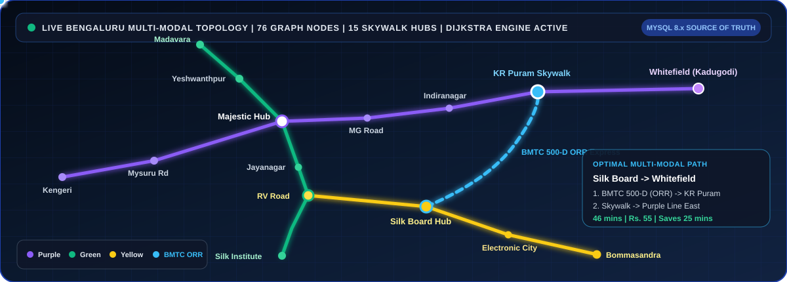
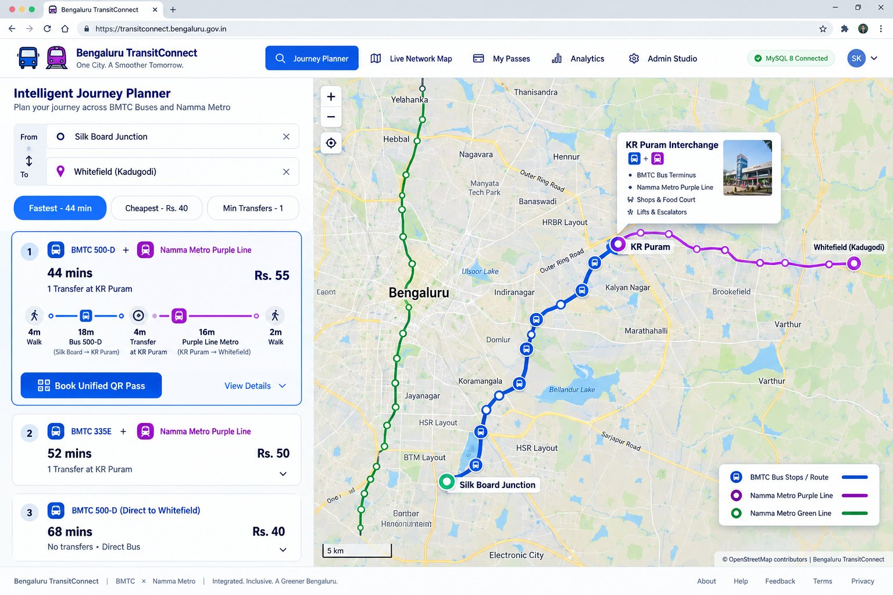
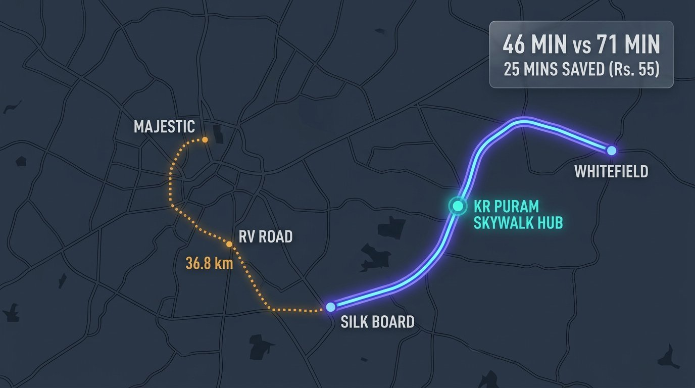
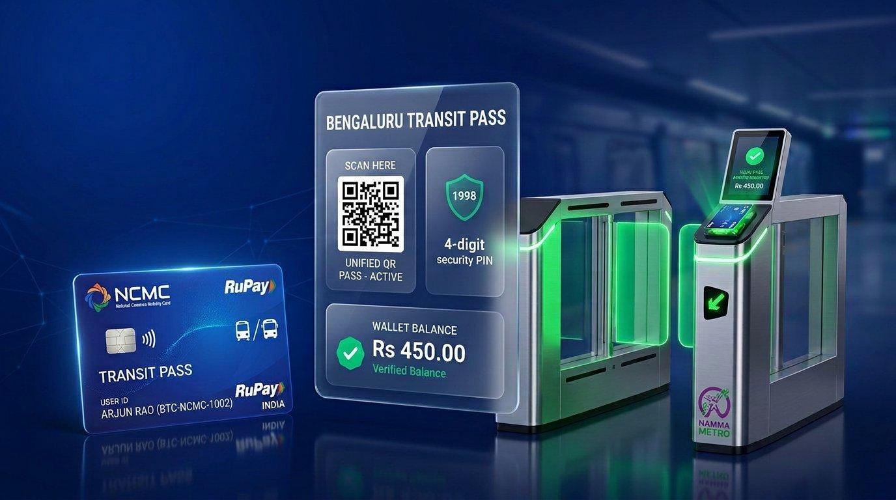
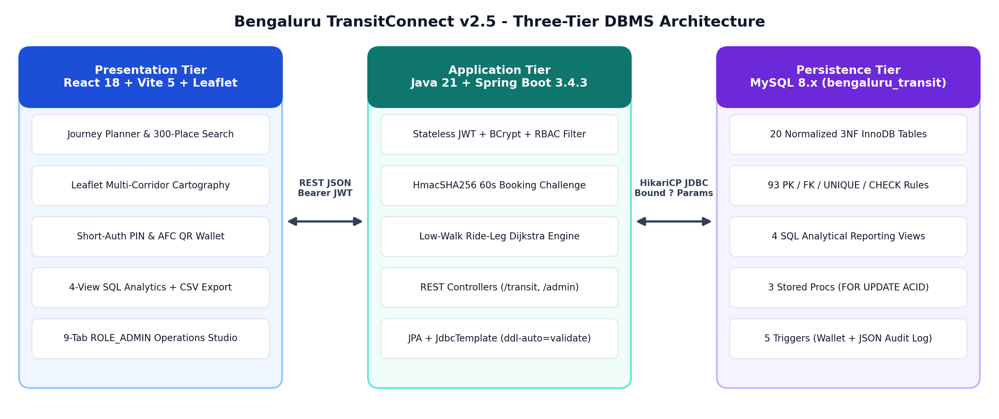
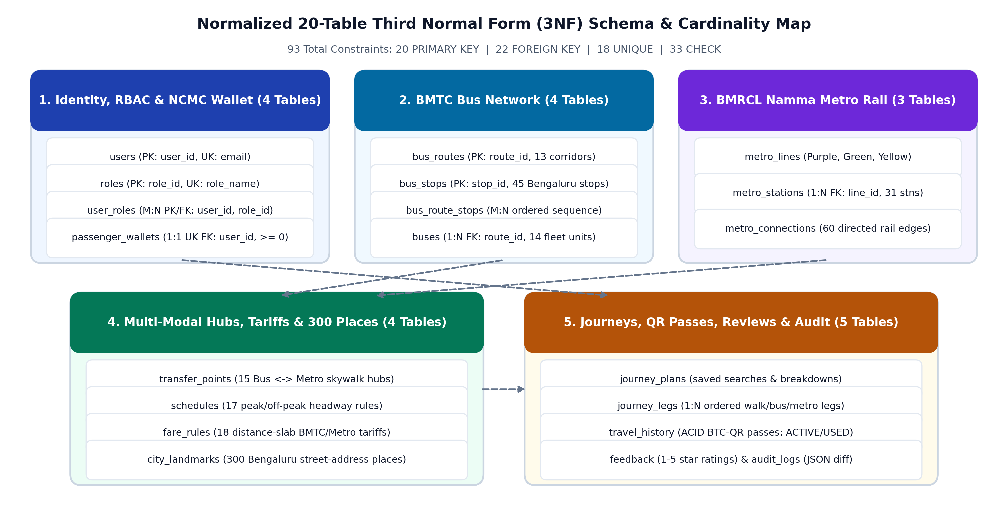
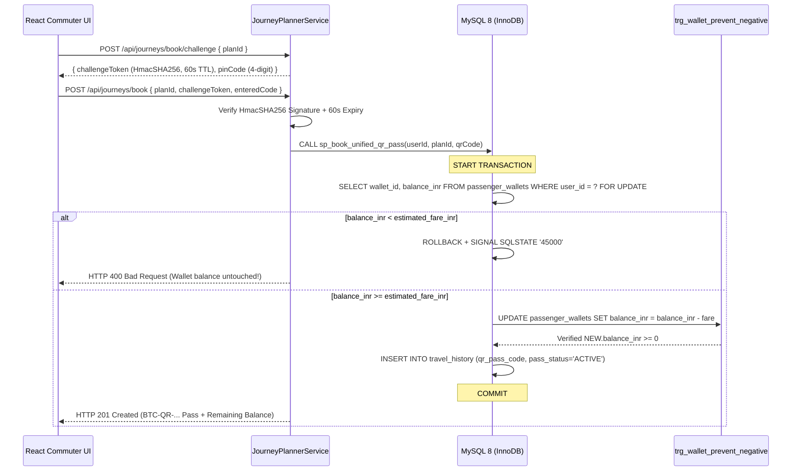

<a id="readme-top"></a>

<div align="center">


<h1>Bengaluru TransitConnect <code>v2.5 Smooth Pro</code></h1>

<p>
  <strong>Intelligent Multi-Modal Route Optimizer &bull; Short-Auth ACID NCMC Smart Wallet &bull; Live 20-Table MySQL 8 (<code>3NF</code>) Transit Studio</strong><br />
  <em>Unifying BMTC Buses + BMRCL Namma Metro (Purple, Green &amp; Yellow Lines) across 300+ Bengaluru Landmarks</em>
</p>

<p>
  <a href="#visual-showcase"></a>
  <a href="#sql-xray-explorer"></a>
  <a href="#api-playground"></a>
  <a href="#visual-showcase"></a>
  <a href="#quick-launch"></a>
  <a href="LICENSE"></a>
</p>

<p>
  <a href="#live-radar"><kbd>&nbsp;Live Network Radar&nbsp;</kbd></a>&nbsp;
  <a href="#visual-showcase"><kbd>&nbsp;Visual Gallery&nbsp;</kbd></a>&nbsp;
  <a href="#interactive-missions"><kbd>&nbsp;5 Interactive Missions&nbsp;</kbd></a>&nbsp;
  <a href="#break-the-db"><kbd>&nbsp;Break-The-DB Lab&nbsp;</kbd></a>&nbsp;
  <a href="#sql-xray-explorer"><kbd>&nbsp;20-Table SQL X-Ray&nbsp;</kbd></a>&nbsp;
  <a href="#api-playground"><kbd>&nbsp;API Playground&nbsp;</kbd></a>&nbsp;
  <a href="#quick-launch"><kbd>&nbsp;1-Command Setup&nbsp;</kbd></a>&nbsp;
  <a href="#viva-quiz"><kbd>&nbsp;Viva Quiz&nbsp;</kbd></a>
</p>

</div>

---

<a id="live-radar"></a>

## Live Animated Bengaluru Multi-Modal Topology

<div align="center">
  
</div>

> [!TIP]
> **Why Multi-Modal Wins in 2026 Bengaluru:** While the Outer Ring Road **Blue Line (Phase 2A: Silk Board -> KR Puram)** is still under construction, single-mode Metro travel from **Silk Board** to **Whitefield (Kadugodi)** detours `36.8 km` west through *RV Road* and *Majestic* (`71 mins`, `2` transfers). **Bengaluru TransitConnect** models `76` stations/stops, `15` skywalk interchanges, and `300+` Bengaluru landmarks in **MySQL 8** so its **Low-Walk Ride-Leg Dijkstra Engine** automatically discovers **`BMTC 500-D` -> `KR Puram Skywalk` -> `Purple Line` (`46 mins | Rs. 55 | Saves 25 mins`)**.

---

<a id="visual-showcase"></a>

## Platform Visual Tour

### 1. Door-to-Door Intelligent Journey Planner &amp; Live Leaflet Cartography

<div align="center">
  
</div>

<br />

<table>
  <tr>
    <td width="50%" valign="top">
      
      <h3 align="center">Low-Walk Ride-Leg Dijkstra Engine</h3>
      <p>
        Computes <strong>Fastest</strong>, <strong>Cheapest</strong>, and <strong>Min Transfers</strong> routes simultaneously across <code>COMBINED</code>, <code>BUS_ONLY</code>, and <code>METRO_ONLY</code> networks. Caps origin/destination walking to <strong>&lt;= 10 mins (0.75 km)</strong> using real MySQL <code>BMTC_ORDINARY</code> feeder hops.
      </p>
    </td>
    <td width="50%" valign="top">
      
      <h3 align="center">Short-Auth PIN Shield &amp; ACID QR Wallet</h3>
      <p>
        Prevents accidental 1-click debits via a 60-second <code>HmacSHA256</code> <strong>4-digit Security PIN</strong> before executing MySQL <code>sp_book_unified_qr_pass</code> with pessimistic <code>SELECT ... FOR UPDATE</code> row locking, offline SVG download, and AFC turnstile scan (<code>ACTIVE -&gt; USED</code>).
      </p>
    </td>
  </tr>
</table>

### 2. MySQL 8 (`3NF`) Relational Core &amp; Dedicated `information_schema` Admin Studio

<div align="center">
  
</div>

<div align="center">
  <table>
    <tr>
      <td align="center"><strong>20</strong><br /><sub>Normalized <code>3NF</code> Tables</sub></td>
      <td align="center"><strong>211</strong><br /><sub>Typed SQL Attributes</sub></td>
      <td align="center"><strong>93</strong><br /><sub>PK / FK / UQ / CHECK Rules</sub></td>
      <td align="center"><strong>300+</strong><br /><sub>Bengaluru Places + Pincodes</sub></td>
      <td align="center"><strong>4 Views + 5 Triggers</strong><br /><sub>+ 3 ACID Stored Procs</sub></td>
      <td align="center"><strong>7 / 7 Indexed</strong><br /><sub><code>0</code> Full-Table Scans</sub></td>
    </tr>
  </table>
</div>

---

<a id="interactive-missions"></a>

## Choose Your Interactive Mission (Click Any Card to Launch)

Don't just read code -- pick a live scenario below and try it inside `http://localhost:5173`:

<details open>
<summary><strong>MISSION 01 :: Beat Outer Ring Road Traffic (Save 25 Minutes on Silk Board -&gt; Whitefield)</strong></summary>

<br />

1. Open **Journey Planner** (`http://localhost:5173`) and click the **Silk Board -> Whitefield** corridor pill (or type any of the **300+ Bengaluru landmarks** using <kbd>Up</kbd> <kbd>Down</kbd> <kbd>Enter</kbd> <kbd>Esc</kbd>).
2. Compare the three live mode cards computed from MySQL `schedules`, `transfer_points`, and `fare_rules`:
   - **Combined Shortcut (`RECOMMENDED`)**: `BMTC 500-D` -> `KR Puram Skywalk` -> `Purple Line` = **`46 mins | Rs. 55.00 | 1 Transfer`**
   - **Bus-Only**: Full road corridor = **`59 mins | Rs. 60.00`**
   - **Metro-Only**: `Yellow` -> `RV Road` -> `Green` -> `Majestic` -> `Purple` = **`71 mins | Rs. 60.00 | 36.8 km`**
3. Flip the Leaflet map to **Night Theme** to watch the glowing multi-modal polyline animate across *KR Puram*.

</details>

<details>
<summary><strong>MISSION 02 :: Attempt an Overdraft on a Low-Balance NCMC Wallet (Live MySQL ACID Rollback)</strong></summary>

<br />

1. Click **Sign In** -> select the 1-click demo card **Kavya Nair (`kavya.nair@bengaluru.in` | Wallet: `Rs. 35.00`)**.
2. Search **Silk Board -> Whitefield (`Rs. 55.00`)** and click **Book Unified QR Pass**.
3. Complete the **4-digit Short-Auth PIN** modal.
4. **Watch MySQL Defend Integrity Live:** `sp_book_unified_qr_pass` locks Kavya's `passenger_wallets` row (`FOR UPDATE`), detects `35.00 < 55.00`, executes `ROLLBACK` + `SIGNAL SQLSTATE '45000'`, and returns Kavya's wallet **100% untouched at `Rs. 35.00`** with zero ghost tickets in `travel_history`!

</details>

<details>
<summary><strong>MISSION 03 :: Denied-GPS Commuter Survival Test (Door-to-Door From Any Street Address)</strong></summary>

<br />

1. Block browser location permission (or skip **Use My GPS**).
2. Filter the Origin search bar by **Colleges**, **Govt Offices**, **Tech Parks**, or **Hospitals** (e.g., `"Vidhana Soudha"`, `"RV College of Engineering"`, `"Manipal Hospital"`).
3. **Result:** Zero errors -- `PlaceSearchInput` resolves full street addresses & pincodes from `city_landmarks` (`300` rows) and snaps to the nearest BMTC stop / Metro station within **`<= 10 mins` walking**.

</details>

<details>
<summary><strong>MISSION 04 :: Trigger the Immutable Database Wiretap (<code>ROLE_ADMIN</code> -&gt; JSON Audit Trail)</strong></summary>

<br />

1. Sign in as **Siddharth Kulkarni (`admin@transitconnect.in` / `Admin@123`)** and open **Admin Studio**.
2. Edit any BMTC route distance or slab tariff in **Tariff Matrix (`fare_rules`)** and click **Save**.
3. Open the **Trigger Audit Logs** tab -> inspect the automatic `OLD` vs `NEW` JSON payload written inside MySQL by `trg_bus_routes_after_update` / `trg_fare_rules_after_update` -- impossible for application code to bypass!

</details>

<details>
<summary><strong>MISSION 05 :: X-Ray All 20 SQL Tables Live in the Browser (<code>MySQL Tables &amp; Attributes</code> Mode)</strong></summary>

<br />

1. Inside **Admin Studio**, click the **`MySQL Tables & Attributes`** button in the top-right hero header.
2. Operational KPI cards and CRUD forms disappear cleanly, revealing **only all 20 MySQL `3NF` Base Tables and their 211 live columns** queried directly from `information_schema.COLUMNS` and `KEY_COLUMN_USAGE`.
3. Click **`Inspect SQL / Rows`** on any table card to view its live `SHOW CREATE TABLE` DDL and BCrypt-masked sample rows (`[MASKED_BCRYPT_HASH]`).

</details>

---

<a id="break-the-db"></a>

## Interactive "Try Breaking Our Database" Security &amp; Integrity Lab

Click any attack vector below to see the exact **Defense-in-Depth** layer that neutralizes it:

<details>
<summary><strong>Attack #1 :: Double-Click Race Condition (Two simultaneous QR Pass bookings on Rs. 60 balance)</strong></summary>

<br />

- **Defense:** `sp_book_unified_qr_pass` opens an explicit transaction and runs `SELECT wallet_id, balance_inr FROM passenger_wallets WHERE user_id = ? FOR UPDATE`.
- **Outcome:** InnoDB serializes both requests with an exclusive row lock. Request #1 debits `Rs. 55 -> Rs. 5` and commits; Request #2 unblocks, sees `Rs. 5.00 < Rs. 55.00`, rolls back cleanly with `SQLSTATE '45000'`.

</details>

<details>
<summary><strong>Attack #2 :: Direct SQL Update Forcing Negative Wallet Balance (<code>SET balance_inr = -100</code>)</strong></summary>

<br />

- **Defense:** Dual enforcement via table `CHECK (balance_inr >= 0.00)` **plus** `BEFORE UPDATE` trigger `trg_wallet_prevent_negative`.
- **Outcome:** MySQL aborts the statement immediately before a single negative rupee can ever be persisted.

</details>

<details>
<summary><strong>Attack #3 :: SQL Injection on Dynamic Table Inspector (<code>/api/admin/dbms-schema/users;DROP TABLE...</code>)</strong></summary>

<br />

- **Defense:** `TransitSqlRepository` enforces `^[a-zA-Z0-9_]+$` regex validation **and** checks `information_schema.TABLES WHERE TABLE_SCHEMA = DATABASE() AND TABLE_NAME = ?` via bound `?` parameters before quoting the verified identifier, gated behind `@PreAuthorize` / `ROLE_ADMIN`.
- **Outcome:** `HTTP 400 / 404` rejected before any DDL/row query executes; JUnit test `t15` verifies injection rejection and `[MASKED_BCRYPT_HASH]` redaction.

</details>

<details>
<summary><strong>Attack #4 :: Accidental 1-Click Pass Purchase / Replay Token</strong></summary>

<br />

- **Defense:** `POST /api/journeys/book/challenge` issues a **60-second `HmacSHA256`-signed challenge** bound to `(userId, planId, pinCode, expiryEpochMs)`.
- **Outcome:** Booking without a valid unexpired PIN or BCrypt account password fails with `HTTP 400 Bad Request` before touching MySQL.

</details>

<details>
<summary><strong>Attack #5 :: Regular Commuter Calling Admin CRUD Endpoints (<code>/api/admin/inventory</code>)</strong></summary>

<br />

- **Defense:** Stateless `JwtAuthenticationFilter` + `SecurityConfig` (`hasAuthority("ROLE_ADMIN")`).
- **Outcome:** Rejected at the servlet security filter chain with **`HTTP 403 Forbidden`** (provable in 1 click inside the UI!).

</details>

---

<a id="sql-xray-explorer"></a>

## Architecture &amp; 20-Table `3NF` Schema X-Ray

<div align="center">
  
</div>

<br />

<div align="center">
  
</div>

<br />

### Expand Any Relational Domain to Inspect Exact Tables, Keys &amp; `3NF` Rules

<details>
<summary><strong>Domain 1 :: Identity, RBAC &amp; NCMC Smart Wallets (4 Tables: <code>roles</code>, <code>users</code>, <code>user_roles</code>, <code>passenger_wallets</code>)</strong></summary>

<br />

| Table | Primary Key | Key Columns &amp; Constraints | Normalization Role |
| :--- | :--- | :--- | :--- |
| `roles` | `role_id` | `role_name` (`UNIQUE`), `description` | Eliminates repeating role strings (`ROLE_ADMIN`, `ROLE_PASSENGER`) |
| `users` | `user_id` | `full_name`, `email` (`UNIQUE`), `phone` (`UNIQUE`), `password_hash` (`BCrypt`), `is_active` | Atomic commuter &amp; admin account entity |
| `user_roles` | `(user_id, role_id)` | Composite `PK` + `FK -> users`, `FK -> roles`, `assigned_at` | Pure `3NF` `M:N` junction table |
| `passenger_wallets` | `wallet_id` | `user_id` (`UNIQUE FK`), `smart_card_no` (`UNIQUE`), `balance_inr` (`CHECK >= 0`) | `1:1` row-locked (`FOR UPDATE`) NCMC balance ledger |

</details>

<details>
<summary><strong>Domain 2 :: BMTC Bus Network, Stops &amp; Fleet (4 Tables: <code>bus_routes</code>, <code>bus_stops</code>, <code>bus_route_stops</code>, <code>buses</code>)</strong></summary>

<br />

| Table | Primary Key | Key Columns &amp; Constraints | Normalization Role |
| :--- | :--- | :--- | :--- |
| `bus_routes` | `route_id` | `route_number` (`UNIQUE`), `route_name`, `service_type`, `origin_name`, `destination_name`, `total_distance_km` | `13` BMTC Ordinary, Vajra AC, Feeder &amp; Vayu Vajra corridors |
| `bus_stops` | `stop_id` | `stop_code` (`UNIQUE`), `stop_name`, `area_name`, `latitude`, `longitude`, `is_interchange_hub` | `45` geolocated BMTC bus stops |
| `bus_route_stops` | `route_stop_id` | `route_id` (`FK`), `stop_id` (`FK`), `direction`, `stop_sequence`, `distance_from_start_km`, `travel_mins_from_prev` | Ordered route-stop graph edges (`idx_brs_stop_route`) |
| `buses` | `bus_id` | `route_id` (`FK`), `registration_no` (`UNIQUE`), `bus_type`, `seating_capacity` (`15..90`), `depot_name` | Depot-assigned BMTC fleet units |

</details>

<details>
<summary><strong>Domain 3 :: BMRCL Namma Metro Purple, Green &amp; Yellow Lines (3 Tables: <code>metro_lines</code>, <code>metro_stations</code>, <code>metro_connections</code>)</strong></summary>

<br />

| Table | Primary Key | Key Columns &amp; Constraints | Normalization Role |
| :--- | :--- | :--- | :--- |
| `metro_lines` | `line_id` | `line_code` (`UNIQUE`), `line_name`, `color_hex`, `total_length_km`, `is_operational` | Purple (`#7C3AED`), Green (`#16A34A`) &amp; Yellow (`#EAB308`) line metadata |
| `metro_stations` | `station_id` | `station_code` (`UNIQUE`), `station_name`, `line_id` (`FK`), `station_order`, `latitude`, `longitude`, `structure_type` | `31` elevated &amp; underground Namma Metro stations |
| `metro_connections` | `connection_id` | `line_id` (`FK`), `from_station_id` (`FK`), `to_station_id` (`FK`), `segment_distance_km`, `travel_time_mins` | Directed rail segments &amp; platform interchanges (`Majestic`, `RV Road`, `Jayadeva`) |

</details>

<details>
<summary><strong>Domain 4 :: Skywalk Hubs, Headways, Slab Tariffs &amp; 300+ Landmarks (4 Tables: <code>transfer_points</code>, <code>schedules</code>, <code>fare_rules</code>, <code>city_landmarks</code>)</strong></summary>

<br />

| Table | Primary Key | Key Columns &amp; Constraints | Normalization Role |
| :--- | :--- | :--- | :--- |
| `transfer_points` | `transfer_id` | `hub_name`, `bus_stop_id` (`FK`), `metro_station_id` (`FK`), `walking_distance_m`, `walking_time_mins`, `transfer_buffer_mins`, `has_skywalk` | `15` multi-modal BMTC &lt;-&gt; Metro transfer hubs |
| `schedules` | `schedule_id` | `transport_mode`, `bus_route_id` (`FK`), `metro_line_id` (`FK`), `peak_headway_mins`, `offpeak_headway_mins`, `data_confidence` | Exclusive-arc `CHECK` constraint + honesty badge |
| `fare_rules` | `fare_rule_id` | `service_category`, `min_distance_km`, `max_distance_km`, `fare_inr`, `smart_card_discount_pct` | Official distance-slab tariff matrix (`idx_fare_lookup`) |
| `city_landmarks` | `landmark_id` | `landmark_name`, `category`, `area_name`, `street_address`, `pincode`, `latitude`, `longitude`, `nearest_bus_stop_id`, `nearest_metro_station_id` | `300` real Bengaluru destinations across `10` categories |

</details>

<details>
<summary><strong>Domain 5 :: Dijkstra Plans, QR Pass Ledger, Reviews &amp; Audit Logs (5 Tables: <code>journey_plans</code>, <code>journey_legs</code>, <code>travel_history</code>, <code>feedback</code>, <code>audit_logs</code>)</strong></summary>

<br />

| Table | Primary Key | Key Columns &amp; Constraints | Normalization Role |
| :--- | :--- | :--- | :--- |
| `journey_plans` | `plan_id` | `user_id` (`FK`), `source_name`, `destination_name`, `optimization_type`, `route_category`, `total_time_mins`, `estimated_fare_inr` | Computed multi-modal route summary header |
| `journey_legs` | `leg_id` | `plan_id` (`FK CASCADE`), `leg_order`, `leg_mode`, `from_point_name`, `to_point_name`, `duration_mins`, `leg_fare_inr` | Step-by-step `WALK` / `BUS` / `METRO` / `TRANSFER` breakdown |
| `travel_history` | `history_id` | `user_id` (`FK`), `plan_id` (`FK`), `qr_pass_code` (`UNIQUE`), `fare_paid_inr`, `pass_status` (`ACTIVE`/`USED`/`EXPIRED`) | Atomic QR ticket ledger (`idx_th_user_date`) |
| `feedback` | `feedback_id` | `user_id` (`FK`), `target_type`, `bus_route_id`, `metro_station_id`, `rating` (`1..5`), `review_status` | Moderated commuter corridor ratings |
| `audit_logs` | `log_id` | `table_name`, `record_pk`, `action_type`, `old_payload` (`JSON`), `new_payload` (`JSON`), `created_at` | Immutable trigger-populated audit trail |

</details>

<details>
<summary><strong>Interactive Mermaid Zoom View :: ACID <code>sp_book_unified_qr_pass</code> Transaction Sequence</strong></summary>

<br />



</details>

---

<a id="quick-launch"></a>

## 1-Command Windows Setup &amp; Live Verification Console

<div align="center">
  
</div>

<br />

### Prerequisites
- **Java 21 LTS** (`java -version`) &bull; **Node.js 20+ / 22 LTS** (`node -v`) &bull; **MySQL Server 8.x** *(auto-installed via `winget` if missing)*

```powershell
# 1. Clone Bengaluru TransitConnect
git clone https://github.com/abdulsalam025/Bengaluru-TransitConnect.git "$HOME\BengaluruTransitConnect"
cd "$HOME\BengaluruTransitConnect"

# 2. Provision MySQL 8 + Load 20 3NF Tables, 4 Views, 5 Triggers, 3 Procs & 300 Landmarks
powershell -ExecutionPolicy Bypass -File ".\scripts\setup_mysql.ps1"
powershell -ExecutionPolicy Bypass -File ".\scripts\apply_sql.ps1"

# 3. Start Full Stack (Spring Boot :8080 + React Vite :5173) & Open Browser
powershell -ExecutionPolicy Bypass -File ".\scripts\start_all.ps1"
```

### Seeded 1-Click Demo Personas (`sql/03_seed_bengaluru_data.sql`)

| Persona | Login Credentials | NCMC Card &amp; Balance | What It Unlocks Live |
| :--- | :--- | :--- | :--- |
| **Transit Admin (`ROLE_ADMIN`)** | `admin@transitconnect.in` / `Admin@123` | `BTC-NCMC-0001` (`Rs. 1,500`) | **MySQL Tables &amp; Attributes Explorer**, 9 CRUD Tabs &amp; Trigger `audit_logs` |
| **Commuter (`ROLE_PASSENGER`)** | `arjun.rao@bengaluru.in` / `Pass@123` | `BTC-NCMC-1002` (`Rs. 450`) | Short-Auth PIN Booking, Downloadable SVG QR Pass &amp; AFC Turnstile Scan |
| **ACID Test (`ROLE_PASSENGER`)** | `kavya.nair@bengaluru.in` / `Pass@123` | `BTC-NCMC-1003` (`Rs. 35`) | Live `SQLSTATE 45000` MySQL `ROLLBACK` when booking a `Rs. 55` corridor |

---

<a id="api-playground"></a>

## Copy-Paste REST API Playground (`http://localhost:8080/api`)

<details>
<summary><strong>Playground 1 :: Compute Fastest Multi-Modal Route (Silk Board -&gt; Whitefield)</strong></summary>

<br />

```powershell
$Body = @{
  sourceNodeKey      = "BUS_20"
  destinationNodeKey = "METRO_112"
  optimizationType   = "FASTEST"
  routeCategory      = "COMBINED"
} | ConvertTo-Json

Invoke-RestMethod -Method Post -Uri "http://localhost:8080/api/journeys/search" `
  -ContentType "application/json" -Body $Body |
  Select-Object -ExpandProperty recommended |
  Format-List badgeLabel, totalTimeMins, estimatedFareInr, transferCount, formulaBreakdown
```

</details>

<details>
<summary><strong>Playground 2 :: Query Live MySQL <code>information_schema</code> Catalog as <code>ROLE_ADMIN</code></strong></summary>

<br />

```powershell
$Auth = Invoke-RestMethod -Method Post -Uri "http://localhost:8080/api/auth/login" `
  -ContentType "application/json" -Body '{"email":"admin@transitconnect.in","password":"Admin@123"}'

$Headers = @{ Authorization = "Bearer $($Auth.accessToken)" }

# Returns all 20 Base Tables, 4 Views, 211 Attributes & 93 Constraints
Invoke-RestMethod -Uri "http://localhost:8080/api/admin/dbms-schema" -Headers $Headers |
  Select-Object databaseName, baseTableCount, viewCount, totalAttributeCount, totalConstraintCount
```

</details>

<details>
<summary><strong>Playground 3 :: Full 22-Endpoint REST Contract Matrix</strong></summary>

<br />

| Endpoint | Auth | Description |
| :--- | :---: | :--- |
| `GET /api/health` | Public | Live MySQL 8 ping + active node/route/hub counts |
| `POST /api/auth/register` / `login` | Public | BCrypt registration (`+Rs. 250` wallet) &amp; stateless JWT login |
| `GET /api/auth/me` | JWT | Current commuter profile, roles &amp; live wallet balance |
| `GET /api/transit/network` | Public | `76`-node graph (`31` Metro + `45` BMTC), `13` routes &amp; `15` skywalk hubs |
| `GET /api/transit/places?q=&category=` | Public | Instant search across `300+` Bengaluru landmarks + stations/stops |
| `GET /api/transit/nearby?lat=&lng=` | Public | Executes `sp_find_nearby_transit_nodes` Haversine search |
| `GET /api/transit/fares` | Public | Official BMTC &amp; Namma Metro distance-slab tariff rules |
| `POST /api/journeys/search` | Optional JWT | Multi-modal Low-Walk Dijkstra route optimizer + mode comparison |
| `POST /api/journeys/book/challenge` | JWT | Generates 60s `HmacSHA256` Short-Auth PIN challenge |
| `POST /api/journeys/book` | JWT | Executes ACID `sp_book_unified_qr_pass` (`SELECT ... FOR UPDATE`) |
| `PATCH /api/journeys/passes/{id}/scan` | JWT | Simulates AFC turnstile scan (`ACTIVE -> USED`) |
| `POST /api/journeys/wallet/topup` | JWT | Instant NCMC wallet top-up (`Rs. 10 - Rs. 5,000`) |
| `GET /api/analytics/dashboard` | Public | Live reporting across all `4` MySQL analytical `VIEW`s |
| `GET /api/admin/dbms-schema` | `ROLE_ADMIN` | Live `information_schema` catalog (`20` tables, `211` columns, `PK`/`FK`/`UQ`) |
| `GET /api/admin/dbms-schema/{table}` | `ROLE_ADMIN` | Whitelisted `SHOW CREATE TABLE` DDL + BCrypt-masked rows |
| `GET/POST/PUT/DELETE /api/admin/**` | `ROLE_ADMIN` | 9-tab transit CRUD + `audit_logs` trigger stream |

</details>

---

<a id="viva-quiz"></a>

## Self-Scoring DBMS Viva &amp; Architecture Quiz (Click to Reveal Answers)

Score yourself (+20 pts per question) before your Viva or technical interview:

<details>
<summary><strong>[20 pts] Q1 :: Why not store a route's bus stops as a JSON array inside <code>bus_routes</code>?</strong></summary>

<br />

**Answer:** A JSON stop array violates **`1NF`** (repeating non-atomic groups), blocks foreign-key integrity to `bus_stops`, causes update anomalies whenever stop coordinates change, and prevents indexed reverse lookups ("find every route serving *KR Puram*"). Normalizing into `bus_route_stops(route_id, stop_id, direction, stop_sequence)` achieves **`3NF`** and enables composite index `idx_brs_stop_route` (`0` full-table scans).

</details>

<details>
<summary><strong>[20 pts] Q2 :: What happens inside InnoDB if two tabs book passes simultaneously on the same wallet?</strong></summary>

<br />

**Answer:** `sp_book_unified_qr_pass` locks the user's wallet row via `SELECT ... FOR UPDATE` inside `START TRANSACTION`. Tab B blocks at the row lock until Tab A either `COMMIT`s or `ROLLBACK`s, guaranteeing strict serializability on that wallet balance.

</details>

<details>
<summary><strong>[20 pts] Q3 :: How does the Exclusive-Arc <code>CHECK</code> constraint in <code>schedules</code> prevent corrupted rows?</strong></summary>

<br />

**Answer:** `CHECK ((transport_mode = 'BUS' AND bus_route_id IS NOT NULL AND metro_line_id IS NULL) OR (transport_mode = 'METRO' AND metro_line_id IS NOT NULL AND bus_route_id IS NULL))` ensures a schedule belongs to **exactly one** transport mode -- never both and never neither.

</details>

<details>
<summary><strong>[20 pts] Q4 :: Why are <code>audit_logs</code> populated by MySQL <code>AFTER</code> triggers instead of Java service methods?</strong></summary>

<br />

**Answer:** Database-level triggers fire atomically inside the same InnoDB transaction as the `INSERT`/`UPDATE`/`DELETE` -- even if an administrator modifies data via MySQL Workbench or CLI outside Spring Boot. If the parent statement rolls back, the trigger audit entry rolls back with it.

</details>

<details>
<summary><strong>[20 pts] Q5 :: How does the planner keep walking under 10 minutes for off-corridor Bengaluru addresses?</strong></summary>

<br />

**Answer:** Every landmark in `city_landmarks` (`300` rows) stores geocoordinates plus nearest stop links. Within `<= 0.75 km`, `TransitGraphEngine` walks `1-10 mins`; beyond `0.75 km`, it synthesizes a real `BMTC_ORDINARY` feeder leg priced via `fare_rules` with a `4 min` access walk.

</details>

---

<div align="center">

**Built with Java 21, Spring Boot 3.4, MySQL 8 (`3NF`), React 18 &amp; Leaflet for Bengaluru Commuters**  
Released under the **[MIT License](LICENSE)** &bull; <a href="#readme-top"><strong>Back to Top &uarr;</strong></a>

</div>
